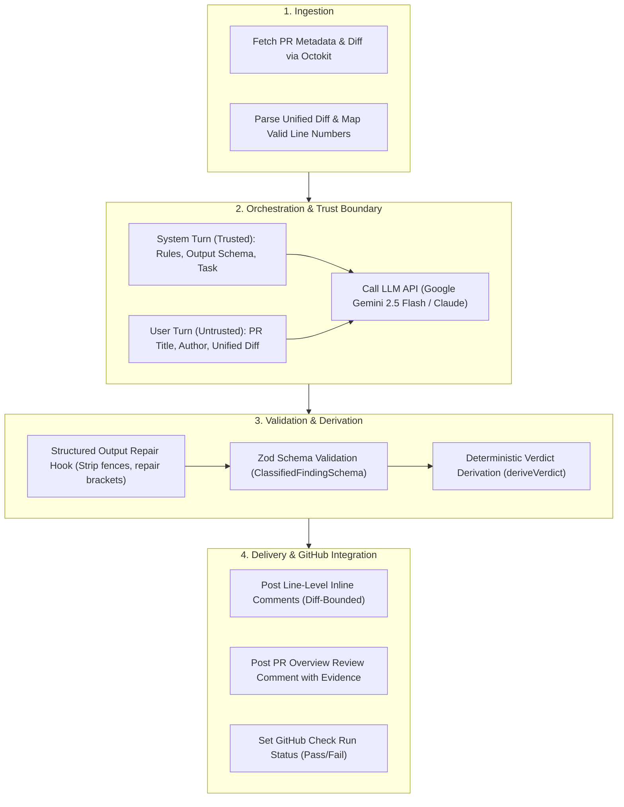

# 🤖 AI Code Reviewer (`@vasantainnovations/ai-code-reviewer`)

> **Production Automated Code Review Agent with Trust Boundary, Ground-Truth Evaluation, and Automated Inline GitHub PR Commenting.**

Part of the **[Vasanta-Innovations](https://github.com/Vasanta-Innovations)** engineering platform.

---

## 🎯 Features

- 🛡️ **Strict Trust Boundary**: Enforces prompt injection defense by separating trusted instructions (System Turn) from untrusted pull request diffs and author comments (User Turn).
- ⚖️ **Framework Ownership of Verdicts**: The LLM predicts findings; the TypeScript framework deterministically derives the review verdict (`APPROVE`, `COMMENT`, `REQUEST_CHANGES`).
- 💬 **Diff-Bounded Inline Commenting**: Automatically posts line-level review comments with markdown evidence (`trigger`, `consequence`, `code_checked`) and suggested code fixes directly on changed lines. Never throws GitHub 422 errors.
- 🚦 **GitHub Checks Integration**: Annotates the commit status check with notices, warnings, and failures.
- 🎯 **Ground-Truth Evaluation Engine**: Built-in benchmark suite with Golden PR datasets and LLM-as-a-judge semantic matcher to track Precision, Recall, and Over-blocking.
- 🔌 **Universal & Plug-and-Play**: Usable as a reusable GitHub Action across all repositories in the organization.

---

## 🏗️ The 4-Stage Architecture



---

## 🚀 Quick Start: Adding to Any Repository

In your repository (e.g. `developer-workspace`, `data-engineering`, `devops-workspace`), create `.github/workflows/ai-code-review.yml`:

```yaml
name: AI Automated Code Review

on:
  pull_request:
    types: [opened, synchronize, reopened]

concurrency:
  group: ${{ github.workflow }}-${{ github.ref }}
  cancel-in-progress: true

jobs:
  ai-review:
    name: AI Review Agent
    runs-on: ubuntu-latest
    permissions:
      contents: read
      pull-requests: write
      checks: write
    steps:
      - name: Checkout Code
        uses: actions/checkout@v4

      - name: Run AI Code Review
        uses: Vasanta-Innovations/ai-code-reviewer@main
        with:
          github-token: ${{ secrets.GITHUB_TOKEN }}
          gemini-api-key: ${{ secrets.GEMINI_API_KEY }}
          approval-preset: 'minor_only'
```

---

## 🎛️ Approval Presets

| Preset | Behavior | Use Case |
|---|---|---|
| `minor_only` *(Default)* | `blocking` → `REQUEST_CHANGES`<br>`important` → `COMMENT`<br>`minor` → `APPROVE` | Standard enterprise production default. Prevents blocking releases on nits. |
| `no_blocking` | Any `blocking` → `REQUEST_CHANGES`<br>All others → `APPROVE` | Fast-paced feature branches or staging repositories. |
| `no_comments` | Any finding of any severity → `REQUEST_CHANGES` | Zero-tolerance repositories (e.g. crypto, core auth, compliance engines). |

---

## 📋 Required Finding Evidence

Every comment posted by the reviewer must contain concrete verifiable evidence:

```markdown
### ⚠️ Issue Title

Detailed description of what is wrong.

<details>
<summary>🔍 <b>Defect Evidence</b></summary>

- **Trigger:** Concrete sequence or input causing the failure
- **Consequence:** Data loss, security breach, or runtime crash
- **Code Inspected:** Exact files and line numbers verified
</details>

```suggestion
// Recommended code fix
```
```

---

## 📊 Ground-Truth Evaluation Engine

The repository includes a golden dataset of pull requests with human-curated ground truth findings. Run the benchmark locally:

```bash
npm run benchmark
```

Output metrics:
- **Precision**: `TP / (TP + FP)` (Target: > 85%)
- **Recall**: `TP / (TP + FN)` (Target: > 80%)
- **F1 Score**: Harmonic mean of precision and recall
- **Over-blocking Rate**: % of good PRs rejected (Target: < 5%)

---

## 🏢 Governance & Standards

This repository adheres to the organization-wide engineering standards maintained in:
- `company-standards` submodule -> `https://github.com/Vasanta-Innovations/company-standards`
- Monitored and maintained by the **vasantainnovationsteam** engineering team.
